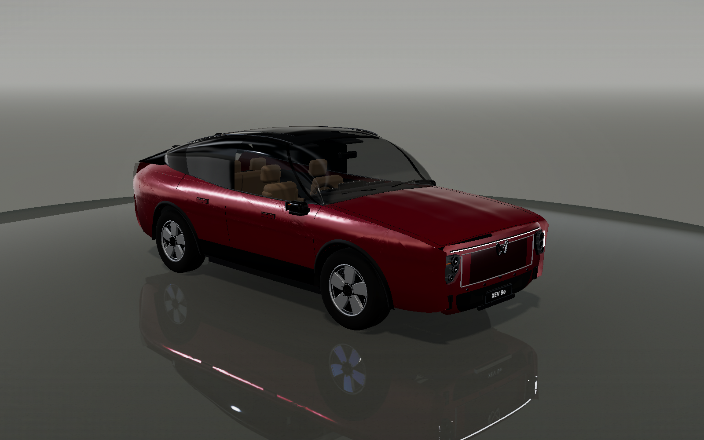
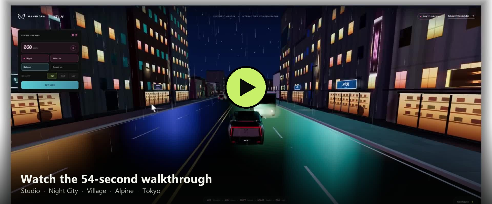
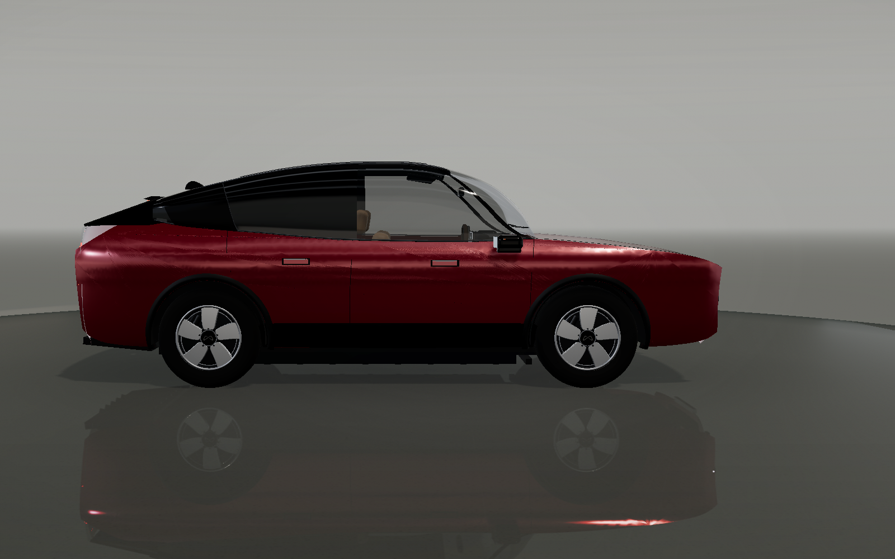
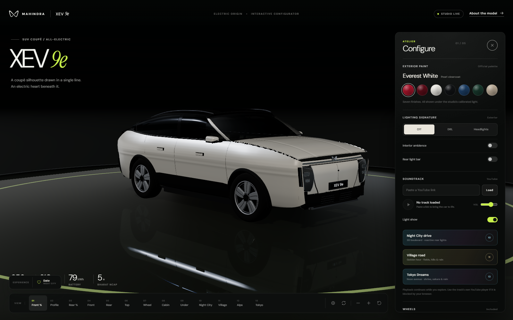

# Mahindra XEV 9e — 3D Configurator

A photorealistic, fully interactive configurator for the Mahindra XEV 9e electric SUV coupé. Every panel, light, wheel, seat and material is generated procedurally in **Three.js** at runtime — there are no imported 3D models, no Blender files and no photographic stand-ins.

The black studio opens into four fully procedural driving stages: a rain-soaked **Night City** boulevard, a golden-hour **village road**, a blue-hour **Alpine pass** under snowfall, and an endless neon **Tokyo** avenue that switches between night and day. Each has live speed control, GTA-style street crowds, a visible driver, traffic that steers and overtakes without collisions, and a sharp, toggleable weather system.

One scripted experience starts from the **Experience** dock: a 22-minute date through Night City, from the kerbside pickup and the drive to Lumière to dinner for two and the walk back to her door. It is a complete drive-out, dinner and drive-home story with a live clock, cinematic camera, procedural characters, spoken lines and procedural foley.



[](https://github.com/velthorix/mahindra-xev-9e-configurator/blob/main/docs/mahindra-xev-9e.mp4)

<p align="center">
  
  
</p>

## Highlights

- **Procedural XEV 9e** — coupé-SUV silhouette, long bonnet, fast roofline, closed grille, twin-peaks emblem, slim full-width DRL, triple-projector headlamps, full-width rear light bar and 19-inch aero alloys.
- **Real paint, real reflections** — seven official colours with metallic base coats, a softer clearcoat, a procedural HDR-style studio and a reflective platform.
- **Surface detail** — low-contrast rubber and leather grain, smoked lamp lenses and machined alloy faces, with no screen-space film grain.
- **Detailed cabin** — dual-tone Dune leather, triple-screen cockpit, RHD steering wheel, console, door cards and ambient lighting, plus a procedural driver whose hands solve onto the live steering rim.
- **Exterior lighting** — a clean lamps-off default with Off / DRL / Headlights modes, plus rear light bar and interior ambience toggles.
- **Motion** — optional rolling wheels with steering, plus a slow auto-orbit.
- **Night City and Village** — Night City with sodium street lighting, dense facades, lane markings, 18-car collision-free traffic and eight shop workers behind lit counters; Village with farmhouses, a church, a windmill, hedgerows, utility poles, crop fields, cyclists, motorbikes, sparse sports cars, pedestrians and a layered hill/mountain horizon.
- **Alpine pass** — a snow-laden stage with chalets, pine forests, a frozen lake, faceted mountains, chimney smoke, string lights, a road plough, buses and cars, and heavy snowfall that replaces rain. The village square adds a fountain, Christmas tree, market stalls, benches and a timber bus shelter; nine street lamps, snow poles, ski-lift chairs, a church clock and a hillside of distant lights carry the blue-hour detail. A sparse procedural alphorn melody, valley echo and distant bells sit under the wind.
- **Tokyo Dreams** — an endless neon avenue with night/day, neon, rain and High/Med/Low quality controls, clickable district signs, and a Drive mode with a cockpit speed/gear HUD, keyboard and touch throttle, steering, boost and brake.
- **One cinematic experience** — a 22-minute Night City date with an 11-beat timeline: kerbside pickup, the open door, seating, the drive to Lumière, arrival, walking in, seating at the corner table, dinner, the drive home, the doorstep goodbye and the final wave. In-world time advances at story speed while the real sequence runs for about a minute and a half.
- **Date characters** — Anaya and the player use a tailored procedural rig with a fitted torso, shirt placket and buttons, detailed eyes with iris, pupil, glint and lids, nose bridge, lips, blush, earrings, necklace, coat, bag and cutlery, plus a side-swept fringe, face-framing locks and a low bun. They blink, talk, breathe, walk, sit, eat and wave; the passenger door is a real hinged proxy that follows the selected paint.
- **Living streets** — instanced procedural crowds with tapered torsos, jointed limbs, faces, hair, clothing details, bags and rain umbrellas. Walkers stride, idlers breathe, shop staff reach over counters and umbrellas open when it rains.
- **Drive controls** — a 0–202 km/h speed slider, rain/snow toggle for every stage, and a live stage HUD. The driver appears when the car rolls, the steering wheel and front wheels steer, the car shifts and yaws gently in its lane, nearby traffic biases the line, and AI cars steer through lane changes and overtakes. A global pairwise separation pass keeps every city and village vehicle clear of every other one.
- **Procedural audio** — rain, traffic, horns, birds, wind, Alpine music, crowd murmur and date foley are synthesised with Web Audio. Mission dialogue uses the platform speech synthesiser.
- **Looping YouTube soundtrack** — the default XEV 9e track (`youtu.be/6x3wzc4ijQQ`) starts with the studio and loops until another YouTube link is pasted into the soundtrack field. Playback and the reactive rear light show continue across every stage, with a mute-then-tap fallback for browser autoplay rules.
- **Thirteen camera views** — Front ¾, Profile, Rear ¾, Front, Rear, Top, Wheel, Cabin, Underbody, Night City, Village, Alps and Tokyo, with free orbit, zoom, reset and responsive framing.
- **Premium interface** — a black studio theme, editorial typography, a closeable configurator with a floating reopen pill, paint swatches, a loading sequence and an info panel.
- **Responsive** — works on desktop and mobile. Desktop gets a full-height sidebar with an explicit close button; mobile gets a bottom sheet that closes on save.

## Vehicle reference

| Specification | Value |
| --- | --- |
| Length × width × height | 4,789 × 1,907 × 1,694 mm |
| Wheelbase | 2,775 mm |
| Wheels / tyres | 19-inch aero alloy, 245/55 R19 |
| Battery | 79 kWh |
| Peak power | 210 kW |
| MIDC range | 656 km |

Official paint options in the configurator: Tango Red, Ruby Velvet, Everest White, Stealth Black, Nebula Blue, Deep Forest and Desert Myst.

## Controls

| Action | Control |
| --- | --- |
| Orbit | Drag on the car |
| Zoom | Scroll, pinch, or the +/- buttons |
| Camera views | The view rail at the bottom, or the `V` key for the village |
| Reset | Reset button |
| Auto-orbit | Orbit button |
| Rolling wheels | Wheel-motion button |
| Paint / lighting / ambience | Configure panel |
| Close configurator | The X in the panel, or the Configure pill to reopen it |
| Drive speed | HUD speed slider (0–202 km/h) |
| Weather | HUD rain / snow toggle |
| Tokyo settings | Day/night, neon, rain and quality buttons in the Tokyo HUD |
| Tokyo Drive | The Drive button in the Tokyo HUD |
| Tokyo throttle / steer / boost / brake | `W` `A` `S` `D`, `Shift`, `Space` |
| Exit Tokyo Drive | `Esc` or the Exit car button |
| Experiences | Date in the Experience dock |
| End an experience | End button in the mission card |
| Save configuration | Save configuration button |

## Run locally

```bash
npm install
npm run dev
```

Vite serves the app at `http://localhost:5173/`.

Production build:

```bash
npm run build
npm run preview
```

## Tech stack

- [Three.js](https://threejs.org/) `^0.186.1` — WebGL 2 renderer, PBR materials, procedural geometry, PMREM studio environment, reflections and post-processing.
- **Vite** — development server and production bundling.
- **Vanilla JavaScript, HTML and CSS** — no framework.
- **Canvas 2D** — grille maps, number plate, screen UIs, ambient textures and floor grain.
- **Fonts** — DM Sans, Instrument Serif and Helvetiker, self-hosted in `public/fonts/`.

## Project structure

```text
.
├── index.html                 # Configurator shell and UI
├── public/fonts/              # Self-hosted typefaces
├── src/
│   ├── main.js                # Renderer, camera, composer, lighting, UI state
│   ├── style.css              # Black studio configurator and responsive layout
│   ├── missions.js            # Date sets, characters and cinematic timeline
│   ├── car/
│   │   ├── body.js            # Surfaces, cladding, bonnet, underbody, battery
│   │   ├── greenhouse.js      # Roof, pillars, glass, spoiler, mirrors
│   │   ├── front.js           # Fascia, grille, DRL, headlamps, bumper
│   │   ├── rear.js            # Tailgate, light bar, bumper, diffuser
│   │   ├── wheels.js          # Aero alloys, tyres, brakes, emblem
│   │   ├── interior.js        # Cabin, seats, screens, steering, console
│   │   ├── driver.js          # Procedural seated driver with IK arms
│   │   ├── materials.js       # Paints, glass, alloys, lights and trim
│   │   └── utils.js           # Surface, curve and extrusion helpers
│   ├── audio/
│   │   └── ambience.js        # Procedural weather, traffic, voices and music
│   └── scene/
│       ├── studio.js          # Backdrop, floor, lights and reflections
│       ├── nightCity.js       # Night City boulevard, traffic, shops and crowd
│       ├── village.js         # Village, fields, props, road actors and crowd
│       ├── alps.js            # Snowy Alpine pass, chalets, lake and snowfall
│       ├── tokyo.js           # Neon avenue, endless drive, day/night and quality
│       ├── people.js          # Instanced procedural pedestrian rig
│       ├── rain.js            # Sharp line-segment rain system
│       └── textures.js        # Canvas-drawn maps and decals
├── tools/
│   ├── render.mjs             # Headless studio renderer (Playwright + Vite)
│   ├── check-ui.mjs           # Desktop/mobile end-to-end UI verification
│   └── shots/                 # Latest studio and UI renders
└── package.json
```

## Design notes

The car is modelled in metres with **+X forward, +Y up and +Z to the car’s right**, with the origin on the ground at the centre of the wheelbase. Side surfaces are built from traced silhouettes with wheel-arch cut-outs, then warped across the width; the bonnet, roof, bumpers and lights are separate assemblies so details stay crisp.

The studio is fully procedural: a gradient backdrop sphere, fogged outer floor, reflective turntable, contact shadow and an emissive PMREM environment made from overhead strips and side bounce cards. This keeps the paint reflections stable without shipping an HDR file.

For performance, repeated details share geometry and materials where possible, the pixel ratio is capped, and the studio renders **on demand**. The GPU idles completely when the car is static; camera damping, view tweens, wheel motion and light transitions schedule frames only while they are moving. The key shadow map is frozen after the establishing frame. The composer is deliberately minimal — `RenderPass` + `OutputPass` with MSAA and no bloom — so highlights stay sharp instead of blooming into soft points. Driving stages keep the same restrained lighting, and their rain is built from crisp `LineSegments` rather than sprite cards.

The roof uses a dedicated satin clearcoat and dark, low-environment glass so the near-horizontal canopy never turns the night sky into one broad white reflection. Paint changes keep the roof, tailgate and body in sync.

The street crowds are one instanced rig: heads, hair, faces, torsos, jacket hems, pockets, cuffs, bags, umbrellas and jointed limbs are separate `InstancedMesh` batches sharing a handful of materials, so a full crowd costs a few dozen draw calls. Walkers use an opposed arm/leg stride, workers reach over their counters, and the same rig appears in both stages. The driver is a separate procedural figure; its hands are solved onto the steering rim with two-bone IK every frame, so the arms follow the wheel instead of floating beside it. The village foliage shares a single `uWindTime` uniform, which gives hedges, crops and tree canopies a slow wind without per-plant animation.

The desktop configurator is a real sidebar: it opens with the studio, closes from its own X, and recentres the camera when dismissed. The floating Configure pill reopens it, and entering a driving stage gets the panel out of the way automatically. The production composer remains `RenderPass` + `OutputPass` with MSAA and no bloom, so rain, lamps and wet-road highlights stay sharp.

The Alpine stage swaps rain for a GPU snowfall field, keeps the same traffic contract as the other stages, and adds a long-delay alphorn voice so the pass feels like a valley rather than a diorama. Snowfall density follows the weather toggle; the music and wind continue under the stage mix.

The date is a small procedural film rather than a cutscene baked into the stage. The house, restaurant and dining room are parked in world space beside the car and revealed when the script calls for them. Anaya and the player use the same jointed rig family as the crowd, upgraded with tailored clothing, faces and seated poses; the passenger door is a real hinged proxy that follows the selected paint. Pickup, drop-off and the walk to the restaurant all follow the pavement and front path instead of cutting through the garden hedge, and the player holds the open door from the kerb side so both figures stay readable. The mission director owns the camera, the speed slider and the driver state while active, then hands control back to the stage. The in-world clock advances at story speed (22 minutes) while the real sequence runs for roughly a minute and a half, with shot cuts, dialogue cues and foley kept on the same timeline.

The Alpine realism pass is built around layers rather than a single backdrop: a snowy village square with a fountain, Christmas tree, market stalls and benches; chalets with window boxes, icicles and wreaths; a ski lift, snow poles and nine practical street lamps with warm glow pools; a church clock and cross; and 34 distant hillside lights. Traffic gets headlight and taillight glow sprites and beam pools, the snowbanks are kept low so they never fill the camera foreground, and the camera sits close to the chalet line for a human-scale view of the pass.

Audio is entirely procedural: filtered noise beds for rain, wind and traffic, formant-shaped sawtooth voices for crowd murmur, an alphorn built from triangle and sine partials, and a singing-bowl chime with inharmonic partials. Scripted dialogue uses the platform speech synthesiser, while doors, seatbelts, footsteps, glassware, cutlery, pouring and the doorbell are short procedural foley cues.

## QA renders

The `tools/render.mjs` helper starts an in-process Vite server and captures the car headlessly with Chrome + SwiftShader:

```bash
node tools/render.mjs hero front profile back rear --size 1600x1000
node tools/render.mjs hero:everest-white front:nebula-blue
```

It uses `?clean=1&view=<name>&paint=<id>` and the `window.__XEV` QA hook. Use `view=night`, `view=village`, `view=alps` or `view=tokyo` to capture a driving stage. To view the car without UI chrome, append `?clean=1` to the dev URL. To render only the DOM interface on a flat studio background — useful for isolating a browser compositor problem from WebGL — append `?static=1`. The QA helpers launch the locally installed Chrome and use `playwright-core`; the executable path at the top of each helper can be adjusted for other platforms.

## Disclaimer

This is an independent design and engineering study. It is not affiliated with, endorsed by or sponsored by Mahindra & Mahindra Ltd. “Mahindra”, “XEV 9e” and the twin-peaks mark are trademarks of their respective owner.
